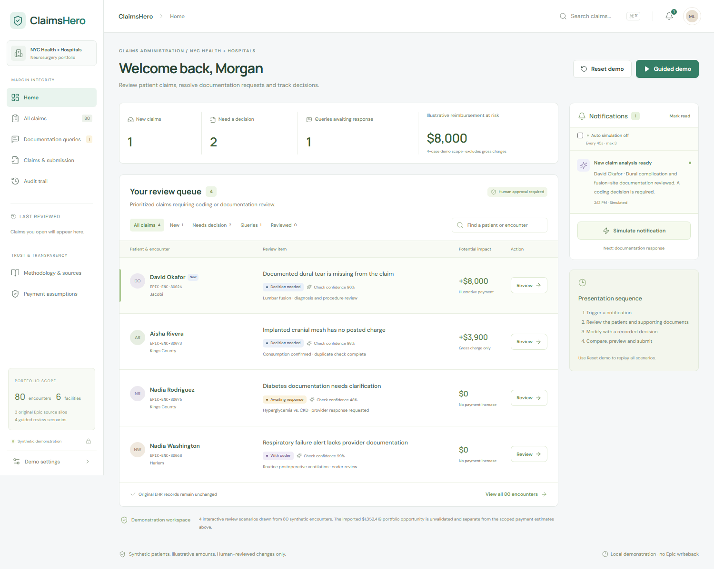

# ClaimsHero

A local, interactive claims-administration demonstration built with React, TypeScript, Zod and Vite. The two main screens follow the supplied wireframe: a queue-first administrator home with notifications and Last reviewed, and a patient review with agent analysis, linked clinical documentation, discrepancies and persistent Modify/Submit actions. Uses the supplied **80 synthetic NYC Health + Hospitals encounters**, with four complete review scenarios. No production Epic, clearinghouse, payer, or AI service is connected.

## Screenshots



[View the source-linked coding review screenshot](docs/screenshots/claimshero-documentation.png).

## Run

```powershell
npm install
npm run dev
```

Open `http://127.0.0.1:5173`. Review state, notifications, unread status, last-reviewed history and the audit trail persist in this browser. **Reset demo** restores the starting queue without changing the source files.

## Presenter walkthrough

1. Select **Guided demo**, then **Trigger notification**. The featured claim becomes ready for review, and the unread count increases.
2. Open **New claim analysis ready**. Compare the current claim, G97.41 recommendation and G97.48 alternative. Open the linked operative note and source excerpt.
3. Select **Modify**, enter a specific reason, confirm source review and approve the coding changes. Reject and coder-routing options are also available.
4. Review the **451 → 448** DRG comparison and the explicit illustrative payment calculation, then open the corrected claim preview.
5. Select **Submit** from the preview, or **Simulate reviewed submission** in the guide. Return home to see the updated claim and Last reviewed entry.
6. Trigger the next two notifications to demonstrate a diabetes documentation response and a coder's rejection recommendation. Neither event changes claim codes or bypasses human approval.

Automatic notifications arrive every **45 seconds**, up to three events. Use the checkbox in Notifications to pause/resume, or **Simulate notification** for deterministic presentation. Reset restarts the event sequence. The featured case has a clearly marked, pre-seeded synthetic clarification so the main flow does not wait on a provider; the diabetes case starts with an open query.

```powershell
npm run build
npm run preview
npm test
npm run test:browser
```

Browser tests use Python Playwright and an already-running local server. If needed, install the testing dependencies with `pip install playwright` and `python -m playwright install chromium --only-shell`. Set `CLAIMSHERO_URL` to test another preview URL.

## Change the demo

- `src\demoScenarios.ts`: starting queue, synthetic documentation context, coder persona and event timing.
- `src\paymentAssumptions.ts`: illustrative payment allowances and charge assumptions.
- `src\notifications.ts`: the three event transitions; notifications never modify claim snapshots.
- `src\portfolio.ts` and `src\data\imported.json`: read-only imported cases, source mapping and labeled clinical extensions.
- `src\workflow.ts`: approval gates, code-to-documentation links, scoped grouper and audit logic.
- `src\ClaimsHome.tsx`, `src\ClaimsReview.tsx` and `src\claimshero.css`: the wireframe-based primary screens.

## Four walkthroughs

| Encounter | Review | Outcome |
|---|---|---|
| EPIC-ENC-80026, David Okafor | Lumbar fusion, documented dural tear, separately signed anemia clarification | Review linked source excerpts, approve corrected procedures/diagnoses, compare DRG/payment and simulate submission. |
| EPIC-ENC-80076, Nadia Rodriguez | Diabetes documentation query | Compare E11.9, E11.65 and E11.22; CKD requires a documented stage. Multiple supported complications can coexist. No automatic payment increase. |
| EPIC-ENC-80073, Aisha Rivera | Missing implant charge | Approve a separate $3,900 illustrative ledger correction. DRG and expected payment remain unchanged. |
| EPIC-ENC-80068, Nadia Washington | False-positive respiratory failure alert | Reject unsupported J95.821, retain the original claim and record the disposition. |

For each proposed code, **Code-to-documentation links** opens its source, exact supporting excerpt, author, available timestamp, documentation status and reviewer status. Clinical records are read-only. Requests, responses, routing and escalation do not modify claim codes; only an approved change does.

## Coding and financial corrections

The supplied reference is retained for provenance but is not treated as authoritative:

- **D62 and G97.41 are CCs, not MCCs.**
- **MS-DRGs 459/460 were retired before these encounters.** The featured July 2026 discharge uses FY2026 v43.1. Its defensible scoped comparison is **451 to 448**, based on two qualifying fusion sites, not an inferred MCC.
- L4-L5 and L5-S1 use **0SG00AJ plus 0SG30AJ**. The imported 0SG10AJ shortcut does not describe the lumbosacral site.
- The original **$1,352,419** portfolio difference is displayed as an **unvalidated illustrative estimate**, not approved recovery. The corrected hero scenario explicitly assumes $31,800 for 451 and $39,800 for 448; these are not CMS payment rates.
- Acquisition costs, gross charges and expected reimbursement are separate. No cost saving is inferred from OR duration, and no charge-only correction is counted as payment recovery.
- Other imported mappings, including FY2027 discharges and NY Medicaid APR-DRG pricing, require specialist validation. Approval is deliberately restricted to the four scoped scenarios.

CMS references and the complete assumptions are linked in the application. This is a bounded grouping demonstration, not a certified CMS grouper or production-ready billing record.

## Source preservation

`public\inputs` contains byte-for-byte copies of all nine attachments plus a SHA-256 manifest. The five 80-row CSV tables were reconciled field-by-field with the read-only SQLite database. `scripts\import_inputs.py` performs that import; it never executes the supplied Python scripts or updates the source database.

Git preserves the original bytes under `public\inputs` without line-ending conversion. The supplied Python files are archival inputs with original machine-specific paths, not application entry points.

The three original Epic silos remain separate: Nurse OpTime/UDI-format barcodes, surgeon operative notes, and recovery nursing/labs/MAR. Original note timestamps, signature metadata and LOINC identifiers were not supplied and are not fabricated. LOINC mappings, diabetes information, charge-consumption confirmation, the illustrative charge ledger and simulated signed clarifications are explicitly identified as separate demonstration extensions.

The local audit is useful for demonstrating workflow, not a production immutable or compliance-certified audit store. Downloaded claim previews are JSON records, not 837 transactions. Simulated submission can intentionally fail through **Demo settings**, preserving the approved claim for retry.
